<div align="center">

# CodeForge APP

**原生 Android AI 编码、逆向分析与手机操控工作台 · Native Android Client for CodeForge-Go**

[](https://github.com/raine-x/codeforge-mobile/releases/tag/v2.0.1)
[-3DDC84?style=flat-square)](app/build.gradle.kts)
[](app/src/main/java/com/hxy/codeforge/ui)

[中文详版文档 (README_ZH.md)](README_ZH.md) · [English Guide (README_EN.md)](README_EN.md) · [Go 内核 (CodeForge-Go)](https://github.com/raine-x/CodeForge-GO.git)

</div>

---

**CodeForge APP** 是 [CodeForge-Go](https://github.com/raine-x/CodeForge-GO.git) 的原生 Android 宿主客户端（Kotlin + Jetpack Compose）。它将独立运行的 Go Agent 内核、原生排版引擎、无 root `proot + Alpine` 沙箱与设备操控能力整合在手机和平板上，用于端侧代码开发、二进制逆向分析与自动化任务执行。

---

## 系统架构 · Architecture

<div align="center">
  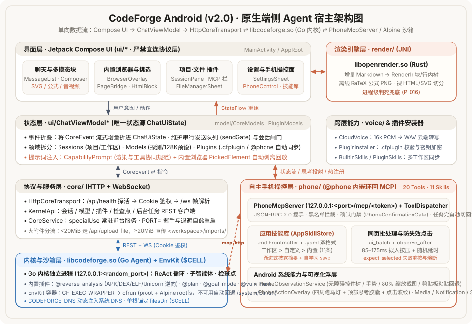
</div>

| 层级 | 核心模块 | 职责 |
|---|---|---|
| **入口与服务** | `MainActivity` · `CodeForgeApp` · `CoreService` | 首启环境准备；`specialUse` 前台服务拉起 `libcodeforge.so` 并维护端口握手与断线重连 |
| **状态与协议** | `ChatViewModel` · `ChatStateFold` · `HttpCoreTransport` · `CoreFrames` | 单向数据流；Cookie 鉴权 + WebSocket 自愈；内核帧解析与状态折叠 |
| **界面与渲染** | `OpenRenderContent` · `MessageBlocks` · `BrowserOverlay` · `FileManagerSheet` | 增量 Markdown/公式/表格/SVG/音视频排版、交互式组件与内置浏览器、统一文件管理 |
| **端侧能力** | `phone/` · `EnvKit` · `PluginInstaller` · `CloudVoice` | `@phone` 环回 MCP 服务、`proot + Alpine` 沙箱、`.cfplugin` 插件管理、云端语音转写 |

---

## 核心工作流 · Workflows

### 1. 端侧编码与沙箱工作区


- **独立内核 + 零 Root 沙箱**：内核以独立进程运行，通过 `cfrun` 在 `filesDir` 单根目录下执行 `proot + Alpine` 命令，支持一键安装 Python、Node 及逆向工具链。
- **富媒体与交互呈现**：支持流式 Markdown、LaTeX 公式、表格、代码块、Diff 工具卡、音视频播放、SVG 矢量图、原生交互卡片与内置浏览器网页。
- **工程化管理**：多工作区隔离、大文件自动直写工作区、统一文件管理器、`.cfplugin` 插件包导入与分步检查点撤销。

### 2. `@phone` 手机操控闭环

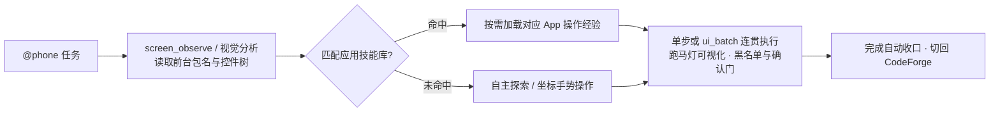

- **内嵌环回 MCP 服务**：在宿主进程内提供 20 个工具，涵盖屏幕观察、点击/滑动/输入、`ui_batch` 连贯动作、应用管理、系统设置、截图分析、录屏录音与通知读取。
- **应用技能库与安全边界**：内置 11 个常用应用技能（工作区 > 自定义 > 内置三层覆盖），并配有应用黑名单、高风险操作确认弹窗、通知栏一键停止与操作轨迹悬浮动画。

---

## 实机截图 · Screenshots

<div align="center">
  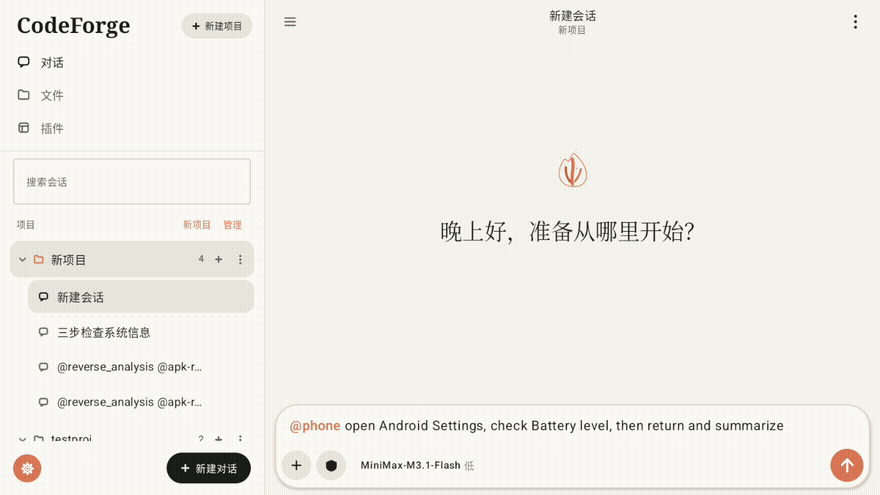
</div>

<br />

| `@phone` 手机操控设置 | 应用技能库 | 操控过程动画 |
| :---: | :---: | :---: |
| 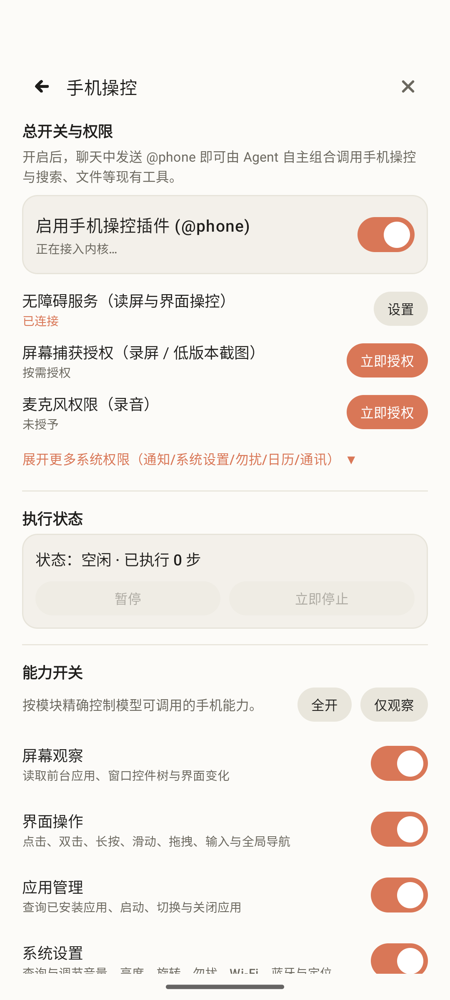 | 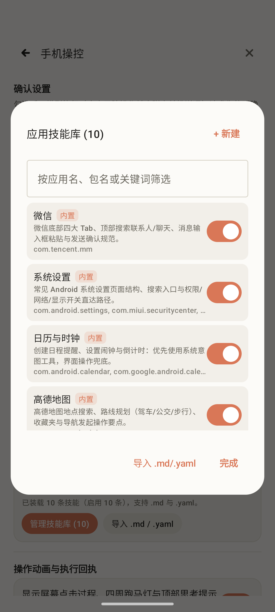 | 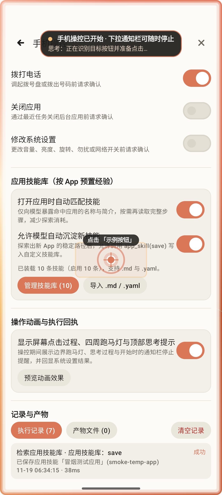 |

| 平板双栏 · 逆向分析报告 | 统一文件管理器 |
|---|---|
| 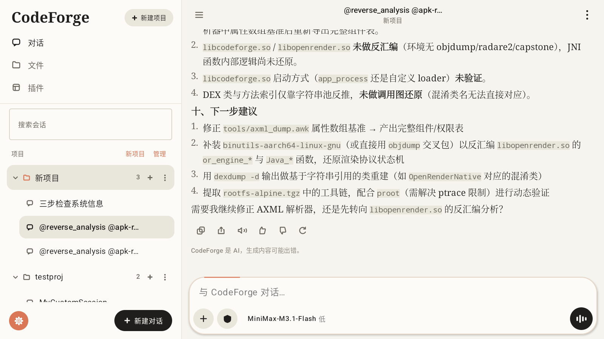 | 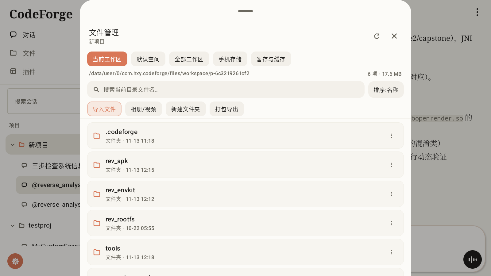 |
| **Markdown 表格与任务追踪** | **插件包与 MCP 管理** |
| 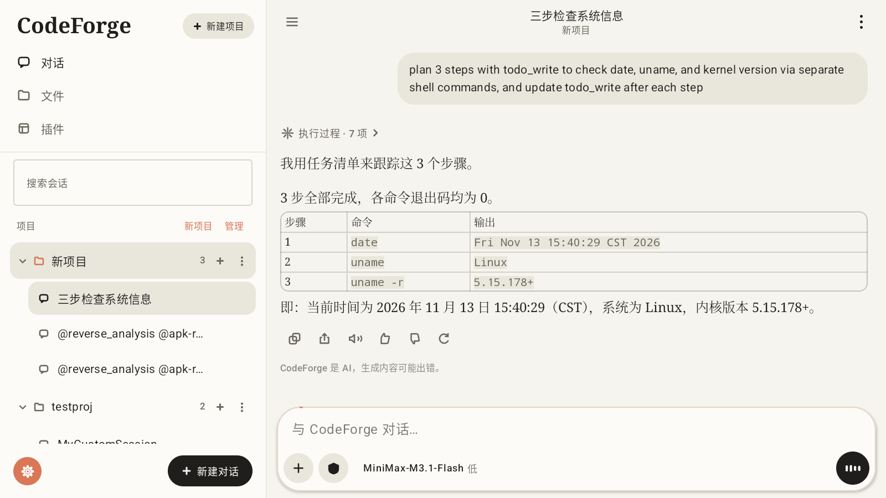 | 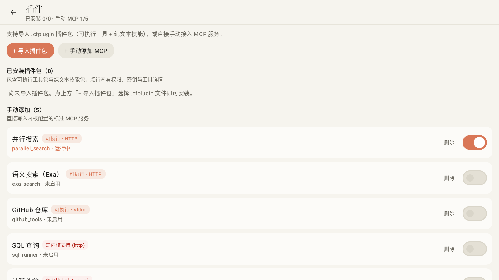 |
| **竖屏单栏聊天** | **竖屏设置页** |
| 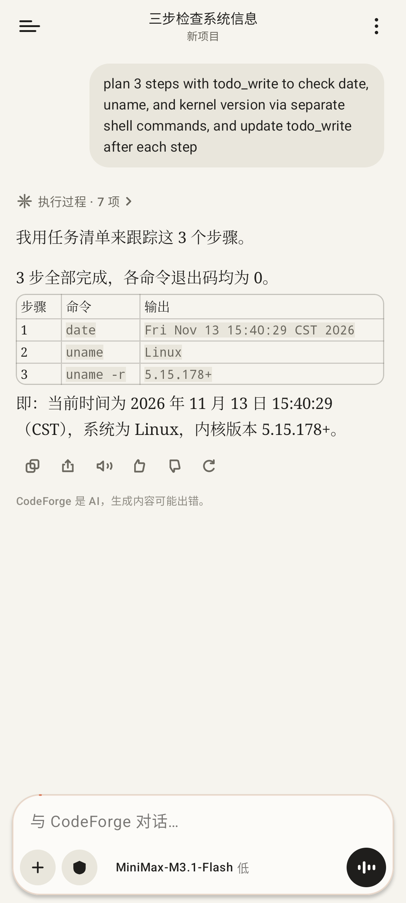 | 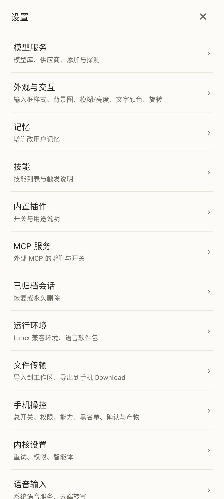 |

---

## 快速开始 · Quick Start

```powershell
# Windows
.\gradlew.bat assembleRelease

# Linux / macOS
./gradlew assembleRelease
```

1. 安装 `app/build/outputs/apk/release/app-release.apk`（`arm64-v8a`，包名 `com.hxy.codeforge`；覆盖安装需同签名证书）。
2. 打开应用等待环境准备完成，在 **设置 → 模型服务** 配置模型供应商与 API Key 即可使用。

---

## 更多文档 · Documentation

- **[中文详版文档（README_ZH.md）](README_ZH.md)** — 架构分层、`.cfplugin` 规范、构建与签名、已知边界。
- **[English Full Guide (README_EN.md)](README_EN.md)** — Full English guide for architecture, plugins, and building from source.
- **[原生化方案与设计（docs/android-native-plan.md）](docs/android-native-plan.md)** — 架构选型与已知风险记录。
