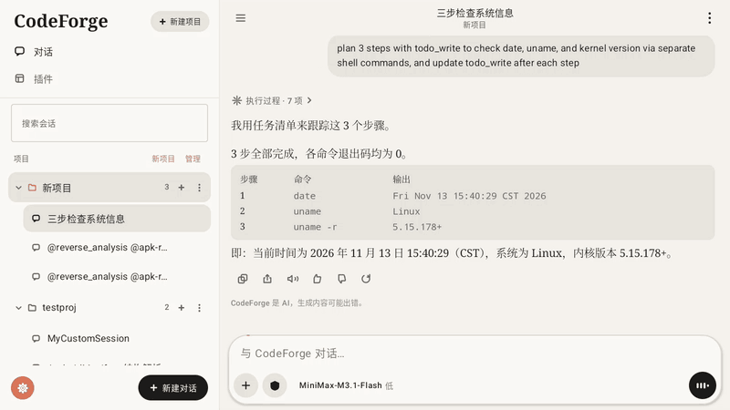
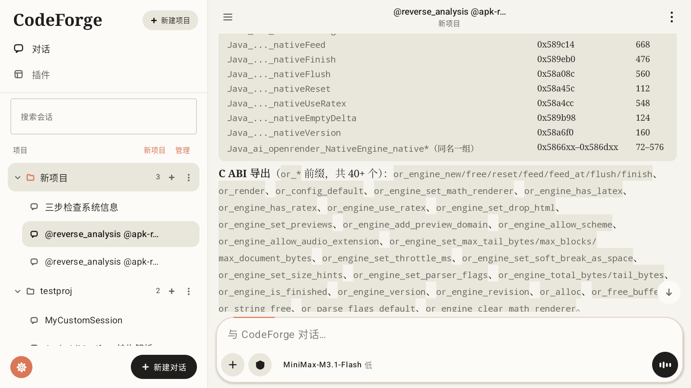
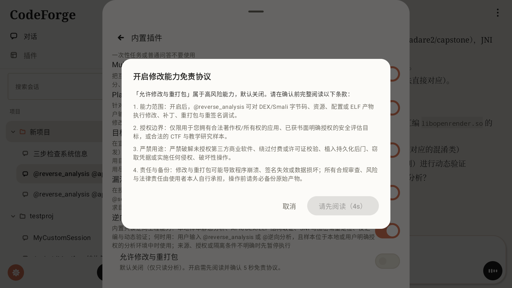
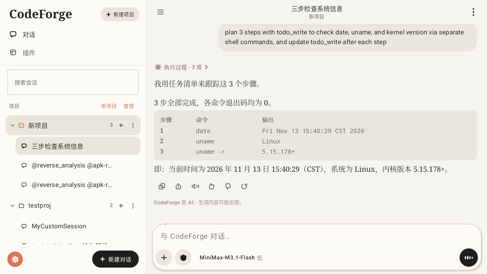
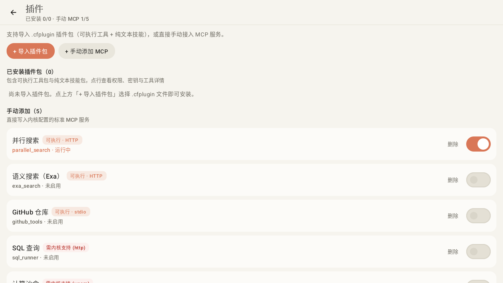
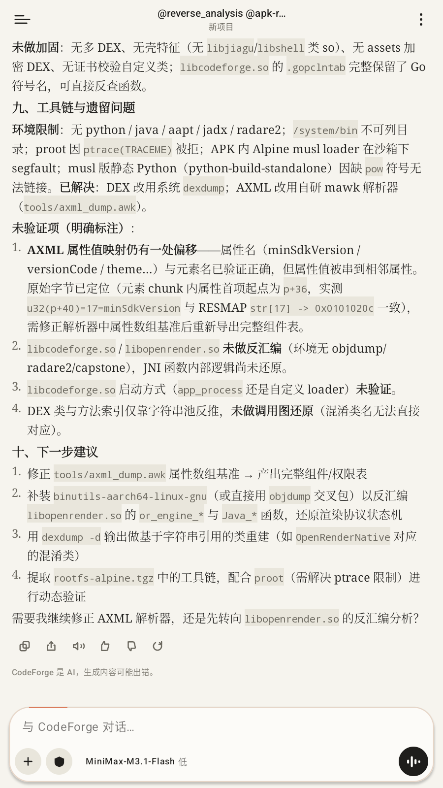
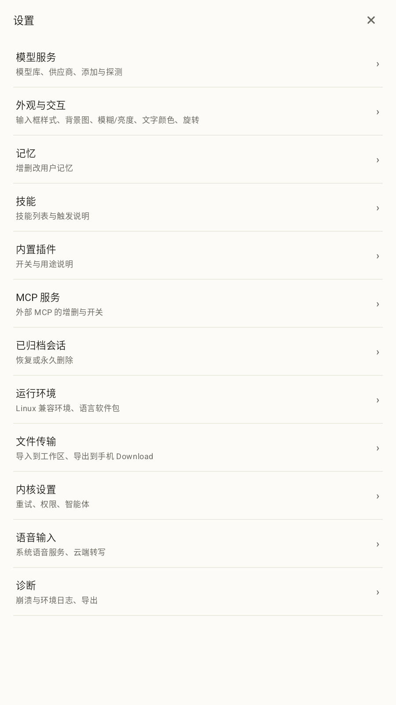

# CodeForge APP

**原生 Android AI 编程与移动安全逆向工作台 · Native Android Client for CodeForge-Go**

[中文完整文档 (README_ZH.md)](README_ZH.md) · [English Documentation (README_EN.md)](README_EN.md)

---

> 双语主 README 聚焦核心功能、实机演示与实测指标；架构分层、插件包规范、构建方式与已知边界见 [README_ZH.md](README_ZH.md) / [README_EN.md](README_EN.md)。
>
> This bilingual overview highlights features, live captures, and measured benchmarks. See [README_ZH.md](README_ZH.md) or [README_EN.md](README_EN.md) for architecture, `.cfplugin` packaging, build instructions, and known limits.

---

## 实机演示 · Live Demo

  
   
  双栏平板布局浏览、@reverse_analysis ELF/JNI 分析报告滚动、插件管理与逆向修改 5 秒免责保护流（Android 14 模拟器实录）

 

| 平板双栏 · 逆向 JNI/ABI 分析报告 | 内置逆向插件 · 修改能力 5 秒强制免责门禁 |
|---|---|
|  |  |
| **Markdown 表格与任务追踪流** | **插件包 (`.cfplugin`) 与 MCP 管理** |
|  |  |
| **竖屏单栏手机模式（高 > 宽自动切换）** | **竖屏全屏设置页** |
|  |  |

---

## 核心功能 · Key Features

### 1. 内置逆向分析插件（`@reverse_analysis` / Built-in Reverse Engineering）

- **全链路只读取证技能栈**：内置 `apk-reverse`（Manifest / DEX 类与字符串索引 `dex_inspector.py`）、`elf-jni-reverse`（ELF 段表 / C ABI / JNI 符号定位 `elf_jni_scanner.py`）、`crypto-unpack`（常见加密常量与壳特征扫描 `crypto_constant_scan.py`）。
- **沙箱逆向工具链一键安装**：在运行环境中内置 `逆向工具` 安装包（`file`、`binutils`、`patchelf`、`radare2`、`py3-capstone`、`py3-unicorn`），随兼容 Alpine rootfs 即可开展二进制分析。
- **高风险修改 5 秒强制免责门禁**：修改与重打包能力默认**关闭**（仅允许只读分析）；在设置页开启「允许修改与重打包」前需强制阅读 5 秒合规免责声明（`REVERSE_MODIFY_DISCLAIMER_SECONDS = 5`），明确授权边界。

### 2. 原生端侧 Coding Agent 宿主 · On-Device Agent Host

- **独立内核进程 + 断线自愈**：以 `specialUse` 前台服务拉起 `libcodeforge.so`，随机本地回环端口 + Cookie 鉴权，HTTP / WebSocket 断线按退避重试自动恢复。
- **流式增量排版与多模态渲染**：基于 `libopenrender.so` 的增量 Markdown IR 渲染，支持公式（RaTeX + 内嵌中文字体子集）、按实测宽度分列的表格、diff 工具卡片、代码块、音频、视频与 SVG 预览。
- **内置浏览器与可视元素挑选**：消息内链接可直接唤起内置 WebView，点选页面节点并将标签、样式、几何位置与用户批注直接送入上下文。
- **模型服务、记忆、检查点与多工作区**：支持多供应商接入、接口探测、连通性测试、自动补齐上下文窗口、分步文件撤销与检查点回滚（`/api/undo` / checkpoints）、按项目隔离的工作区与文件树浏览。
- **`.cfplugin` 动态插件体系与 MCP 接入**：支持导入经过结构、路径遍历与大小校验的 `.cfplugin` 插件包（纯文本技能与可执行 MCP 工具），密钥经 `EncryptedSharedPreferences` 加密保存并同步至各工作区。
- **横竖屏与手机/平板自适应**：以窗口实际纵横比判定布局——竖屏（高 > 宽）自动走单栏抽屉与全屏设置页，横屏（宽 > 高）自动切换双栏工作区，并支持单手横持传感器自适应内容旋转。
- **后台任务、目标验证与双引擎语音**：支持自主后台脚本调度（`@goal_mode` 闭环验证与子智能体协同）、以及系统 `SpeechRecognizer` / 云端 OpenAI 兼容 `/audio/transcriptions` 双引擎语音输入。

---

## 实测指标 · Measured Metrics

> 以下全部数值均来自 **2026-11-14** 本地仓库实测统计与 Android 14 模拟器（`1600×900` @ `240 dpi`，`arm64-v8a` Release 包经 Houdini 转译运行）`adb` 实测采集，无任何估算或营销话术。

| 维度 · Metric | 实测数值 · Measured Value | 采集方式 · Source |
|---|---|---|
| Release 安装包体积（含双 `.so` + Alpine 环境 + 技能库） | **17.58 MiB** (`18,428,777 B`) | `app/build/outputs/apk/release/app-release.apk`（R8 + ShrinkResources，`arm64-v8a`） |
| 核心原生二进制构成 | `libcodeforge.so` **17.00 MiB** + `libopenrender.so` **8.52 MiB** | `app/src/main/jniLibs/arm64-v8a/` |
| 主工程源码与单测规模 | **70** 个主 `.kt` 文件 / **31,793** 行 · **16** 个测试 `.kt` 文件 / **2,140** 行 | `app/src/{main,test}/java/` |
| JVM 单元测试与静态检查 | **113 / 113** 项用例通过（17 个测试套件，0 失败 / 0 跳过），Android Lint **0 错误** | `./gradlew testDebugUnitTest lintDebug` |
| 热态冷启动耗时（`am start -W`，3 次均值/中位） | **276 – 360 ms**（实测：360 / 276 / 283 ms，中位数 **283 ms**） | `adb shell am start -W -n com.hxy.codeforge/.MainActivity` |
| 滚动与切换帧渲染性能（838 帧连续滑动长 Markdown 报告） | 掉帧率 **0.24%**（**2 / 838** 帧），Missed Vsync **0** | `adb shell dumpsys gfxinfo com.hxy.codeforge` |
| 帧耗时分位数（P50 / P90 / P95 / P99） | **9 ms / 9 ms / 10 ms / 11 ms** | `adb shell dumpsys gfxinfo com.hxy.codeforge` |
| 进程内存占用（连接内核后空闲 → 已加载长会话） | **82.9 MB → 120.5 MB PSS**（RSS 197.2 MB → 236.7 MB） | `adb shell dumpsys meminfo com.hxy.codeforge` |

---

## 更多文档 · Documentation

- **[中文详版文档（README_ZH.md）](README_ZH.md)** — 安装与使用指南、逆向分析插件详解、`.cfplugin` 规范、完整架构分层、实测性能数据、CI 与源码构建方式、工程记录与已知限制。
- **[English Full Guide (README_EN.md)](README_EN.md)** — Installation, Reverse Engineering workflow, `.cfplugin` packaging, architecture layers, measured benchmarks, CI setup, building from source, and known limits.
