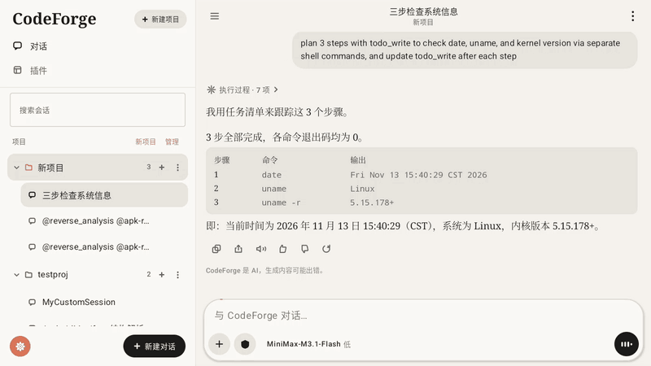
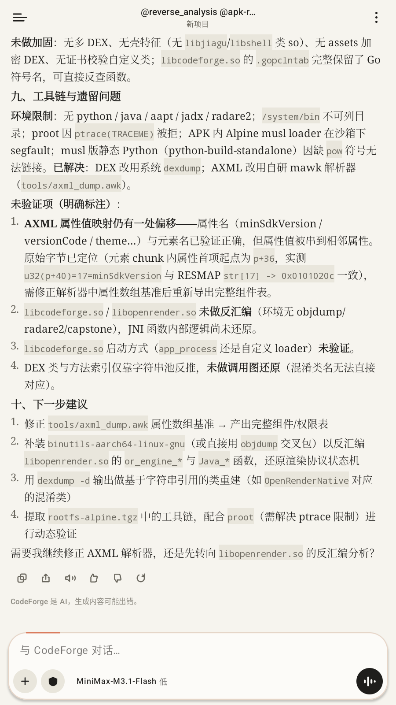
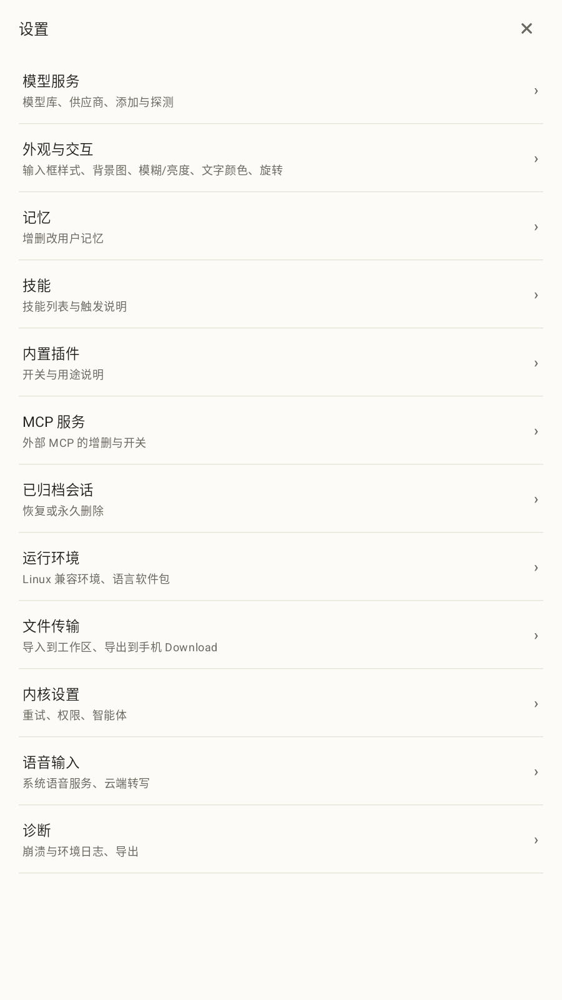
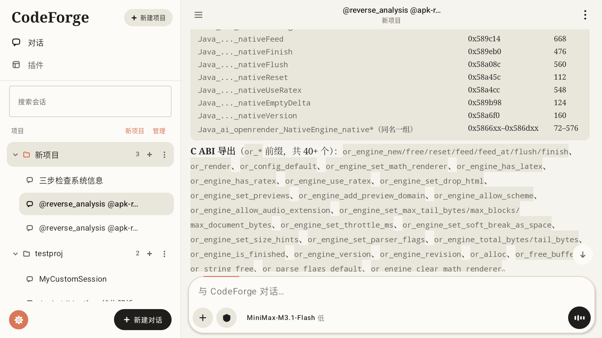
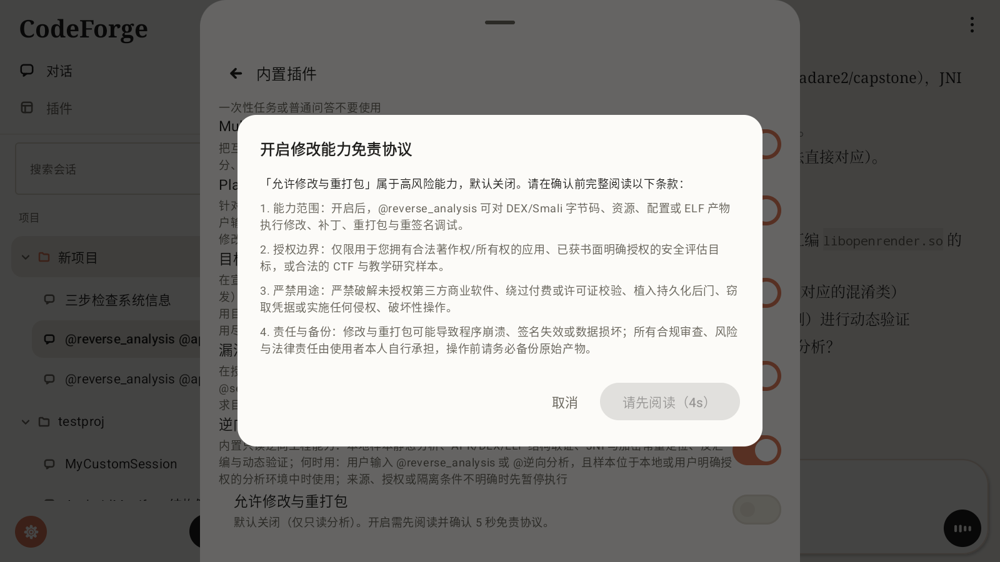
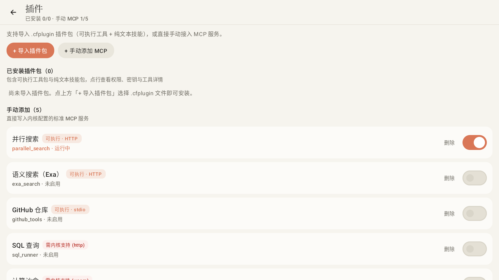

# CodeForge APP · English Documentation

[Back to Bilingual Overview (README.md)](README.md) · [中文完整文档 (README_ZH.md)](README_ZH.md)

---

Native Android client for CodeForge-Go. The Go kernel runs locally as an isolated process handling tool execution and agent orchestration, while the Kotlin + Jetpack Compose shell drives the UI, streaming Markdown layout, and on-device security analysis workflows over HTTP and WebSocket.

<div align="center">
  
</div>

---

## Contents

1. [Quick Start and Everyday Usage](#quick-start-and-everyday-usage)
2. [Built-in Reverse Engineering Plugin (@reverse_analysis)](#built-in-reverse-engineering-plugin-reverse_analysis)
3. [Plugin Packages (.cfplugin) and MCP Extensions](#plugin-packages-cfplugin-and-mcp-extensions)
4. [Measured Performance Benchmarks](#measured-performance-benchmarks)
5. [Architecture and Layered Design](#architecture-and-layered-design)
6. [CI and Building from Source](#ci-and-building-from-source)
7. [Design Principles and Engineering Discipline](#design-principles-and-engineering-discipline)
8. [Current Scope and Known Limits](#current-scope-and-known-limits)
9. [License](#license)

---

## Quick Start and Everyday Usage

### 1. Installation and Model Setup

1. Grab or build `app/build/outputs/apk/release/app-release.apk` (`arm64-v8a` physical devices, or emulators with ARM64 translation).
2. On first launch, `EnvKit` unpacks `env-kit.tgz` (proot) and `rootfs-alpine.tgz` into private app storage in the background (typically ready within 1–2 seconds).
3. Open **Settings → Model Service** to configure providers and models (API keys are encrypted on-device with Keystore-backed `EncryptedSharedPreferences`), probe endpoints, or run live connection checks.

### 2. Core Capabilities

- **Project-Scoped Workspaces**: Create projects bound to any local folder from the sidebar; unbound chats default cleanly to the private `inbox` space. Project switching validates whether any background session is busy before changing the kernel working directory.
- **Multimodal Streaming & Formatting**: Feeds incremental Markdown IR through `libopenrender.so`, rendering LaTeX math (RaTeX with an embedded Noto Sans SC subset), measured-width tables, diff tool cards, code blocks, audio, video, and SVG, while bypassing raw HTML directly into in-stream WebViews.
- **Checkpoints & Step-by-Step Undo**: Every file write is checkpointed per session, allowing workspace rollback or undo (`/api/undo`) straight from session controls.
- **Built-in Browser & Element Picking**: Open links from messages in an embedded WebView, tap **Select Element** to inspect DOM nodes, and attach tag/style/geometry metadata plus user notes directly to the active prompt.
- **Background Tasks & Subagents**: Launch long-running shell scripts into the background task panel to stream output or kill runs; supports `@goal_mode` verifier loops and multi-agent decomposition.
- **Dual-Engine Voice Input**: Prefers user-configured cloud OpenAI-compatible `/audio/transcriptions`, falling back to Android `SpeechRecognizer` with a 20-second no-result watchdog.

### 3. Compatible Linux Runtime (proot + Alpine)

Under **Settings → Runtime Environment**, users can install packages into the Alpine minirootfs with a single tap (verified via standalone existence probes with no masking pipes):

| Category | Packages Installed | Purpose |
|---|---|---|
| Python | `python3 py3-pip` | Scripting, automation, and binary helpers |
| Node.js | `nodejs npm` | JavaScript runtime and tooling |
| Go | `go` | Go toolchain |
| C / C++ | `build-base` | `gcc` and standard build toolchain |
| Rust | `cargo rust` | Rust compiler and Cargo |
| Git | `git` | Source control |
| Java 17 | `openjdk17-jre-headless` | JVM runtime |
| FFmpeg | `ffmpeg` | Media inspection and conversion |
| Reverse Toolkit | `file binutils patchelf radare2 py3-capstone py3-unicorn` | ELF section/symbol inspection, `readelf`/`objdump`, `radare2` disassembly, and Python binary analysis |

### 4. Responsive Portrait / Landscape Layout

Layout mode follows the **live viewport aspect ratio** uniformly across phones and tablets:

| Orientation | Layout Tier | Settings Presentation |
|---|---|---|
| Portrait (`height > width`) | Single-column mobile layout (drawer sidebar collapsed by default) | Full-screen sheet |
| Landscape (`width > height`) | Two-pane tablet layout (`Medium` 600–840dp, `Expanded` ≥ 840dp with 220ms animated sidebar collapse) | Centered modal sheet |

On phones locked to portrait, an accelerometer-based pose detector rotates page content smoothly with hysteresis when held sideways.

| Portrait Single-Column Mode (`height > width`) | Portrait Full-Screen Settings |
|---|---|
|  |  |

---

## Built-in Reverse Engineering Plugin (`@reverse_analysis`)

CodeForge APP bundles a dedicated mobile static-analysis and binary forensics workflow designed with safety guardrails:

### 1. Bundled Reverse Skills

| Skill | Scope | Helper Script Bundled |
|---|---|---|
| `apk-reverse` | APK archive audit, `AndroidManifest.xml` inspection, multi-DEX class/string recovery, packer detection | `references/dex_inspector.py` |
| `elf-jni-reverse` | `.so` ELF header/section/dynamic symbol parsing, C ABI exports, `JNI_OnLoad` and `Java_*` symbol mapping | `references/elf_jni_scanner.py` |
| `crypto-unpack` | Known crypto constant detection (AES S-box, TEA, MD5/SHA, CRC32) and unpacking triage | `references/crypto_constant_scan.py` |

Mention `@reverse_analysis` (or `@逆向分析`) in any chat to engage the specialist workflow; combined with the one-tap `Reverse Toolkit` package in Runtime Settings, the agent inspects APKs and native libraries directly in the workspace.

### 2. Read-Only by Default + Mandatory 5-Second Modify Disclaimer

| Two-Pane Landscape · ELF/JNI Analysis Report | Mandatory 5s Disclaimer Before Enabling Modification |
|---|---|
|  |  |

- **Safe Default**: Out of the box, `@reverse_analysis` is strictly **read-only**—no patching, repackaging, or re-signing tools are permitted.
- **5-Second Compliance Guard**: Enabling **"Allow Modification & Repackaging"** under **Settings → Built-in Plugins → Reverse Analysis** triggers a mandatory 5-second countdown disclaimer (`REVERSE_MODIFY_DISCLAIMER_SECONDS = 5`) keeping the confirm button disabled until read, restricting modification exclusively to software you own or have explicit written authorization / lawful CTF scope to test.

---

## Plugin Packages (`.cfplugin`) and MCP Extensions

Beyond built-in plugins, CodeForge APP imports `.cfplugin` archives (text-only skill bundles or executable `mcp` / `mcp-http` packages) alongside manually configured MCP servers.

<div align="center">
  
</div>

```json
{
  "schema": 1,
  "id": "weather",
  "name": "Weather",
  "version": "1.0.0",
  "type": "mcp-http",
  "endpoint": "https://api.example.com/mcp",
  "skills": [],
  "permissions": { "secrets": ["API_KEY"] }
}
```

- Pure skill bundles set `"type": "skill"` with entries under `skills/<name>/SKILL.md` matching `skills[]` one-to-one.
- **`SKILL.md` rule**: YAML frontmatter must use flat single-line fields (no `|` or `>` block scalars) so the kernel parser reads triggers cleanly.
- **Security & Validation**: Archives are capped at **8 MiB** compressed, **32 MiB** extracted, and **512** entries; path traversal (`..`) and absolute entry paths are rejected outright. Required `permissions.secrets` prompt masked inputs on install, persist encrypted via Keystore, sync across workspaces automatically, and clean up cleanly on uninstall.

---

## Measured Performance Benchmarks

All numbers below were measured on **2026-11-14** with the `app-release.apk` build running on an Android 14 emulator (`1600×900` @ `240 dpi`, x86_64 host translating `arm64-v8a` via Houdini) via `adb`:

| Measurement | How Measured | Result |
|---|---|---|
| Release APK footprint | `app-release.apk` (R8 + `shrinkResources`, `arm64-v8a`) | **17.58 MiB** (`18,428,777 B`) |
| Bundled native binaries & assets | `jniLibs/arm64-v8a/` & `assets/` | `libcodeforge.so` **17.00 MiB**, `libopenrender.so` **8.52 MiB**, `rootfs-alpine.tgz` **3.84 MiB**, `builtin-skills.zip` **0.72 MiB**, `env-kit.tgz` **0.13 MiB** |
| Cold start latency (3 warmed-ART runs) | `adb shell am start -W -n com.hxy.codeforge/.MainActivity` | **360 ms / 276 ms / 283 ms** (median **283 ms**) |
| Frame stability scrolling long Markdown reports (838 frames) | `adb shell dumpsys gfxinfo com.hxy.codeforge` | **2 / 838** janky frames (**0.24%**), **0** missed Vsync |
| Frame duration percentiles | `adb shell dumpsys gfxinfo com.hxy.codeforge` | **P50 = 9 ms · P90 = 9 ms · P95 = 10 ms · P99 = 11 ms** |
| Memory footprint (idle connected → loaded long session) | `adb shell dumpsys meminfo com.hxy.codeforge` | **82.9 MB → 120.5 MB PSS** (RSS 197.2 MB → 236.7 MB) |
| Source & Verification Scale | `app/src/{main,test}/java/` + `testDebugUnitTest` + `lintDebug` | **70** main `.kt` files (**31,793** lines) · **16** test `.kt` files (**2,140** lines) · **113 / 113** tests green · Lint **0 errors** |

---

## Architecture and Layered Design

```text
User Input → UI (Compose) → State (ChatViewModel) → Protocol (CoreTransport) → Kernel (libcodeforge.so)
    ↑                                                                                    │
    └──── Recompose ←──── StateFlow<ChatUiState> ←──── CoreEvent ←──── WebSocket / HTTP ─┘
```

| Layer | Modules / Key Files | Responsibilities |
|---|---|---|
| **Entry** | `MainActivity.kt`, `CodeForgeApp.kt`, `CoreService.kt` | Edge-to-edge window, notification channel/permissions, crash log capture, first-run `EnvKit` bootstrap, `specialUse` service spawning `libcodeforge.so` with `PORT=` handshake |
| **State** | `ChatViewModel.kt` + split domain files:<br>`ChatViewModelSessions.kt` (sessions/projects/archive/branch)<br>`ChatViewModelModels.kt` (models/providers/kernel config/tasks)<br>`ChatViewModelPlugins.kt` (`.cfplugin`/MCP lifecycle)<br>`ChatViewModelWorkspace.kt` (tree/elements/drafts/memory/compression) | Owns single source of truth `ChatUiState`, serializes queued sends, isolates background session frames, imports zero Android UI |
| **UI** | `AppRoot.kt`, `ui/chat/` (`Composer.kt`, `ComposerPanels.kt`, `MessageList.kt`, `OpenRenderMessage.kt`, `MessageBlocks.kt`, `StatusStrips.kt`), `ui/sessions/`, `ui/settings/` (`SettingsSheet.kt`, `SettingsModelSection.kt`, `KernelSettingsSection.kt`, `ModelEditorSection.kt`), `ui/browser/` | Pure Compose rendering; forbidden from importing protocol classes or owning independent business state |
| **Render Bridge** | `render/OpenRenderNative.kt`, `render/RenderIr.kt` | JNI wrapper around `libopenrender.so` with process-level `nativeDead` text fallback and code-fence-aware LaTeX delimiter normalization |
| **Protocol & Core** | `core/CoreTransport.kt`, `core/HttpCoreTransport.kt`, `core/KernelApi.kt`, `core/EnvKit.kt`, `core/PluginInstaller.kt`, `core/PluginSkills.kt` | 36 REST endpoints + auto-reconnecting WebSocket, `codeforge_token` cookie auth, single-root `$CELL` proot wiring, and `.cfplugin` installer |

---

## CI and Building from Source

### 1. GitHub Actions CI (`.github/workflows/android-ci.yml`)

Every push or pull request to `main` executes:
1. JDK 17 (Temurin) + Android SDK + Gradle 8.14.6 setup
2. `./gradlew testDebugUnitTest --no-daemon` (all **113** JVM unit & source-guard tests)
3. `./gradlew lintDebug --no-daemon` (Android & Compose Lint checks)
4. `./gradlew assembleDebug --no-daemon` and uploads test/lint reports + Debug APK artifact

### 2. Local Commands

```bash
# Run all JVM unit and architecture-guard tests
./gradlew testDebugUnitTest

# Run Android Lint checks
./gradlew lintDebug

# Build Debug APK
./gradlew assembleDebug

# Build R8-minified Release APK (app/build/outputs/apk/release/app-release.apk)
./gradlew assembleRelease
```

Both `libcodeforge.so` and `libopenrender.so` are shipped prebuilt under `app/src/main/jniLibs/arm64-v8a/`, so building the Android client requires no Go, Rust, or NDK setup.

---

## Design Principles and Engineering Discipline

- **Compile-Time Boundary Enforcement**: UI never imports `HttpCoreTransport`; ViewModel never imports Compose; `render/` depends on neither UI nor networking.
- **Automated Regression Guards**: **17** test suites (`TaskListThemeAndSyncTest`, `MentionListScrollTest`, `ResponsiveTest`, `NoOfflineVoiceTest`, `BuiltinSkillsTest`, `PluginInstallerTest`, `CapabilityPromptTest`, `RenderIrTest`, etc.) verify UX invariants, prompt contracts, and architectural constraints.
- **Three-Document Traceability**: `AGENTS.md` (recording **59** documented pitfalls `P-001`–`P-059`), `工作进程.md` (task status), and `改动历史.md` (chronological audit log) maintain complete traceability across every change.

---

## Current Scope and Known Limits

1. **`arm64-v8a` ABI Only**: Only ARM64 native binaries are bundled (emulators on x86_64 require Houdini translation).
2. **`targetSdk = 28` Sideload Target**: Explicitly pinned so Android permits executing `libcodeforge.so` and `proot` binaries unpacked under `filesDir`; not intended for Google Play Store distribution.
3. **Separate Native Sources**: Upstream Go (`libcodeforge.so`) and Rust (`libopenrender.so`) source trees remain outside this repository per `AGENTS.md`.
4. **Sandbox `ptrace` Restrictions**: Some restricted containers or emulators block `ptrace(TRACEME)` needed by `proot`; in those environments, static Python / system tools (`dexdump`, `binutils`) continue to work natively.

---

## License

Dual-licensed under **MIT + Commercial License**. Personal learning, open-source research, and non-commercial use follow MIT; commercial distribution, OEM pre-installation, or closed-source forks require commercial licensing via `2653603072@qq.com`. Third-party licenses are listed in [LICENSE](LICENSE).
