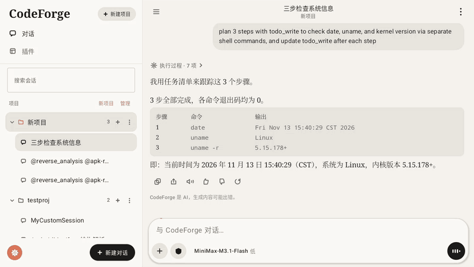
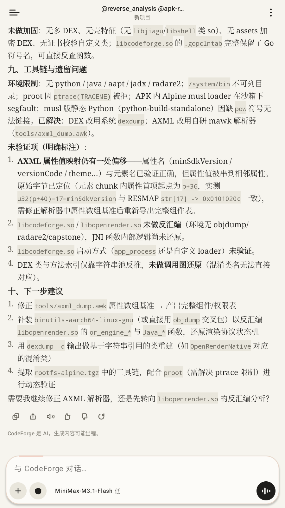
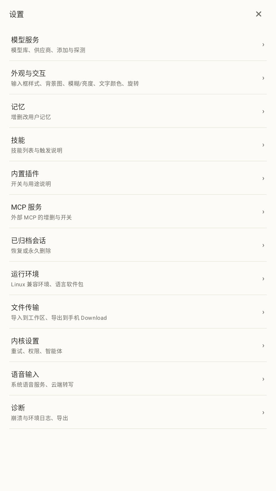
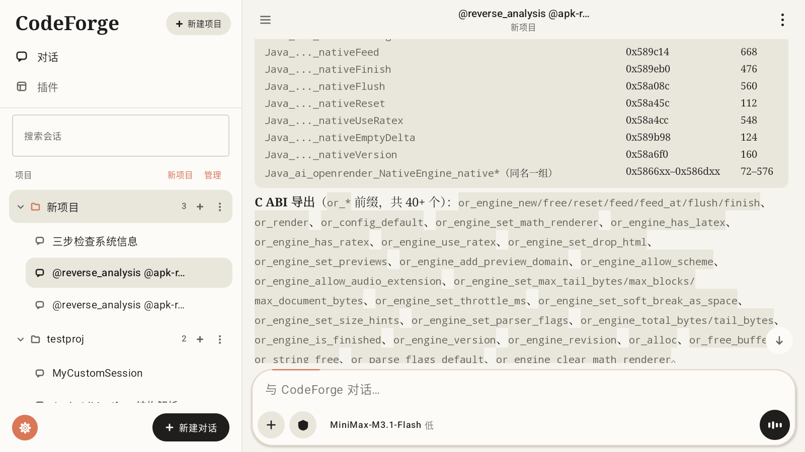
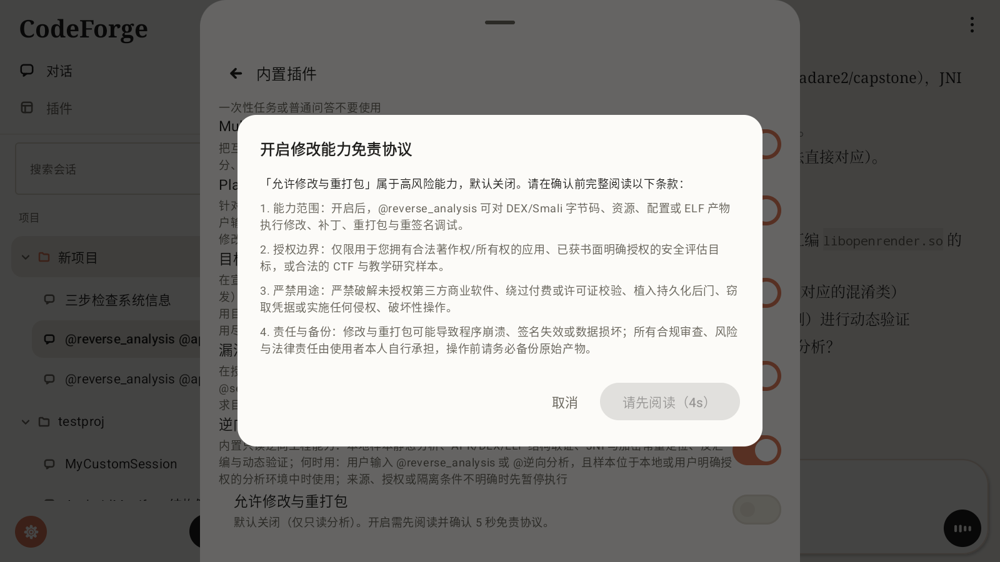
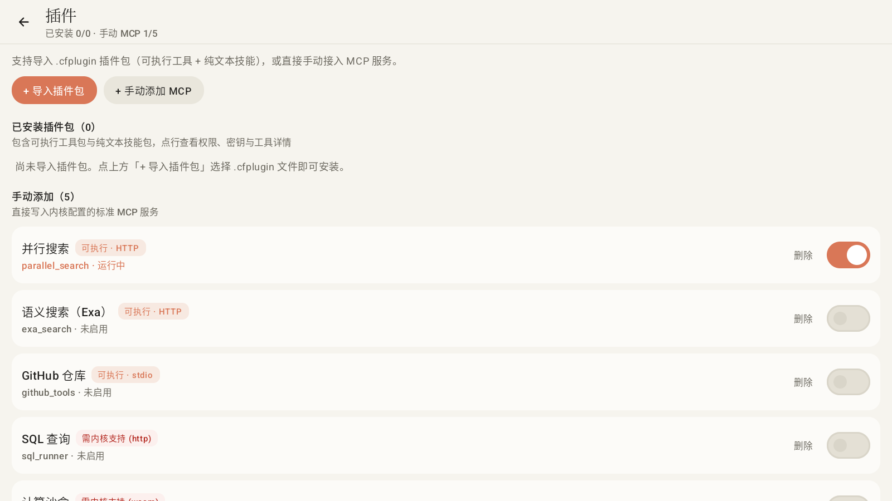

# CodeForge APP · 中文完整文档

[返回双语主文档 (README.md)](README.md) · [English Guide (README_EN.md)](README_EN.md)

---

CodeForge-Go 的原生 Android 客户端。Go 内核作为独立进程在本地跑工具调用与推理编排，Kotlin + Compose 壳通过 HTTP + WebSocket 驱动交互界面、流式渲染与端侧安全取证流程。

<div align="center">
  
</div>

---

## 目录

1. [快速开始与功能用法](#快速开始与功能用法)
2. [内置逆向分析插件（@reverse_analysis）](#内置逆向分析插件reverse_analysis)
3. [插件包（.cfplugin）与 MCP 扩展](#插件包cfplugin与-mcp-扩展)
4. [实测性能指标](#实测性能指标)
5. [架构设计与分层实现](#架构设计与分层实现)
6. [CI 与本地源码构建](#ci-与本地源码构建)
7. [设计原则与工程纪律](#设计原则与工程纪律)
8. [当前边界与已知限制](#当前边界与已知限制)
9. [许可说明](#许可说明)

---

## 快速开始与功能用法

### 1. 安装与连接模型

1. 获取或编译 `app/build/outputs/apk/release/app-release.apk`（仅 `arm64-v8a` 设备，或支持 Houdini 转译的模拟器）。
2. 首启时 `EnvKit` 在后台自动将 `env-kit.tgz`（proot）与 `rootfs-alpine.tgz` 解压至应用私有目录，通常 1–2 秒就绪。
3. 打开 **设置 → 模型服务** 配置模型或供应商（API 地址、密钥经 `EncryptedSharedPreferences` 加密落盘），支持在线接口探测与一键测试连接。

### 2. 日常编码与工作区协同

- **项目与工作区隔离**：侧栏点「新建项目」绑定本地目录；未选择工作区时自动落到应用私有 `inbox` 空间。跨项目切换时壳侧自动校验后台运行态，防止在途工具调用落错目录。
- **消息流与媒体渲染**：通过 `libopenrender.so` 将 Markdown 解析为增量 IR，支持公式（RaTeX + 内嵌 Noto Sans SC 子集）、实测宽度表格、diff 工具卡片、代码块、音频、视频与 SVG 渲染；裸 HTML 自动旁路挂载流内 WebView。
- **检查点与文件撤销**：每次文件改动均按会话记录检查点，可在操作面板回滚工作区文件或撤销最近一步写入（`/api/undo`）。
- **内置浏览器与元素挑选**：消息内链接支持内置浏览器打开；点「选择元素」后可在页面内点选 DOM 节点并附带说明，将标签、样式与位置摘要注入当前对话。
- **后台任务与子智能体**：支持提交长时间脚本至后台任务面板监控与终止；支持 `@goal_mode` 独立验证闭环与多子智能体并行拆解。
- **双引擎语音输入**：已配置云端 OpenAI 兼容 `/audio/transcriptions` 时优先走云端，否则走系统 `SpeechRecognizer`（带 20 秒无响应看门狗）。

### 3. 兼容运行环境（proot + Alpine）

在 **设置 → 运行环境** 可一键按需安装以下环境包（所有安装由单条独立存在性探测校验，避免管道屏蔽退出码）：

| 类别 | 安装包 | 用途 |
|---|---|---|
| Python | `python3 py3-pip` | 脚本、数据处理与反编译辅助脚本 |
| Node.js | `nodejs npm` | 前端构建与脚本执行 |
| Go | `go` | Go 工具链 |
| C / C++ | `build-base` | `gcc` 等基础编译链 |
| Rust | `cargo rust` | Rust 工具链 |
| Git | `git` | 版本控制 |
| Java 17 | `openjdk17-jre-headless` | Java 运行时 |
| FFmpeg | `ffmpeg` | 工作区音视频转码与媒体处理 |
| 逆向工具链 | `file binutils patchelf radare2 py3-capstone py3-unicorn` | ELF 段表符号解析、`readelf`/`objdump`、`radare2` 反汇编与指令级静态分析 |

### 4. 自适应布局与旋转规则

布局严格按**当前可用窗口纵横比**决策（无论手机或平板）：

| 窗口状态 | 布局模式 | 设置页呈现 |
|---|---|---|
| 竖屏（高 > 宽） | 手机单栏模式（默认收起侧栏，改为抽屉呼出） | 全屏展开 |
| 横屏（宽 > 高） | 平板双栏工作区（600–840dp 中栏，≥ 840dp 加宽双栏，220ms 侧栏折叠动画） | 居中弹窗工作表 |

手机竖屏锁定时支持通过加速度计姿态感应实现单手横持内容旋转（平滑动画与迟滞防抖）。

| 竖屏单栏模式（高 > 宽） | 竖屏全屏设置页 |
|---|---|
|  |  |

---

## 内置逆向分析插件（`@reverse_analysis`）

CodeForge APP 内置了专为移动端静态取证与二进制逆向分析设计的技能栈和权限护栏，默认处于**只读分析**状态：

### 1. 内置逆向技能组（自动注入工作区）

| 技能 | 触发 / 用途 | 随包辅助脚本 |
|---|---|---|
| `apk-reverse` | APK 归档盘点、AndroidManifest 解析、多 DEX 类与字符串反查、壳特征识别 | `references/dex_inspector.py` |
| `elf-jni-reverse` | `.so` ELF 段表/动态符号检查、C ABI 导出梳理、`JNI_OnLoad` 与静态 `Java_*` 映射定位 | `references/elf_jni_scanner.py` |
| `crypto-unpack` | 常见对称/摘要算法常数表（AES/S-box、TEA、MD5/SHA、CRC32 等）扫描与脱壳线索排查 | `references/crypto_constant_scan.py` |

在对话中输入 `@reverse_analysis` 或 `@逆向分析` 即可激活该上下文专家；配合运行环境中的 `逆向工具 (binutils/file/radare2)` 安装包，Agent 可直接在端侧工作区分析本地 APK 与 `.so` 产物。

### 2. 默认只读与「允许修改与重打包」5 秒免责保护

| 平板双栏 · ELF/JNI 逆向报告输出 | 5 秒强制阅读免责确认弹窗 |
|---|---|
|  |  |

- **只读默认策略**：首次启用或默认状态下，禁止修改目标 APK 字节码、资源文件、签名或 ELF 产物，仅提供结构取证与逆向分析结论。
- **高风险开关保护**：在 **设置 → 内置插件 → 逆向分析** 下打开「允许修改与重打包」时，客户端会弹出强制阅读倒计时协议窗（`REVERSE_MODIFY_DISCLAIMER_SECONDS = 5`），倒计时未归零前确认按钮不可点击，明确约束仅可用于自有版权应用、明确书面授权目标或合法 CTF / 教学研究。

---

## 插件包（`.cfplugin`）与 MCP 扩展

除内置插件外，客户端支持导入社区标准 `.cfplugin` 归档（纯文本技能包或携带 `mcp` / `mcp-http` 的可执行工具包）及手动添加 MCP 服务。

<div align="center">
  
</div>

### Manifest 与技能格式

```json
{
  "schema": 1,
  "id": "weather",
  "name": "天气查询",
  "version": "1.0.0",
  "type": "mcp-http",
  "endpoint": "https://api.example.com/mcp",
  "skills": [],
  "permissions": { "secrets": ["API_KEY"] }
}
```

- 纯技能包设 `"type": "skill"`，所有技能必须置于 `skills/<名称>/SKILL.md` 并与清单 `skills[]` 一一对应。
- **`SKILL.md` 规范**：YAML frontmatter 必须使用扁平单行键值对，禁止写块标量（`|` / `>`），保证内核解析器零偏差识别。
- **安全与体积校验**：单个 `.cfplugin` 归档上限 **8 MiB**、解压上限 **32 MiB**、条目上限 **512**，拒绝一切包含 `..` 或绝对路径的恶意归档；安装页自动为 `permissions.secrets` 渲染掩码密钥输入框，持久化至 Keystore 支撑的 `EncryptedSharedPreferences`，并在多工作区切换时自动同步技能副本（卸载时精准清理不误删用户自有技能）。

---

## 实测性能指标

以下测试数据均基于 **2026-11-14** `app-release.apk` 在 Android 14 模拟器（`1600×900` @ `240 dpi`，x86_64 宿主 + Houdini 转译 `arm64-v8a`）上的真实 `adb` 测量结果：

| 测试项 | 测量命令 / 工具 | 实测结果 |
|---|---|---|
| Release 安装包大小 | `Get-Item app-release.apk`（R8 + shrinkResources，`arm64-v8a`） | **17.58 MiB** (`18,428,777 B`) |
| 原生库与内置资产构成 | `jniLibs/arm64-v8a` + `assets/` | `libcodeforge.so` **17.00 MiB**、`libopenrender.so` **8.52 MiB**、`rootfs-alpine.tgz` **3.84 MiB**、`builtin-skills.zip` **0.72 MiB**、`env-kit.tgz` **0.13 MiB** |
| 冷启动耗时（ART 预热后 3 轮） | `adb shell am start -W -n com.hxy.codeforge/.MainActivity` | **360 ms / 276 ms / 283 ms**（中位数 **283 ms**） |
| 滚动帧渲染统计（838 帧连续滑动长逆向报告） | `adb shell dumpsys gfxinfo com.hxy.codeforge` | **2 / 838** 掉帧（**0.24%**），Missed Vsync **0** |
| UI 帧耗时分布 | `adb shell dumpsys gfxinfo com.hxy.codeforge` | **P50 = 9 ms · P90 = 9 ms · P95 = 10 ms · P99 = 11 ms** |
| 进程内存占用（连接后空闲 → 加载长会话） | `adb shell dumpsys meminfo com.hxy.codeforge` | **82.9 MB → 120.5 MB PSS**（RSS 197.2 MB → 236.7 MB） |
| 源码与测试规模 | `app/src/{main,test}/java/` + `testDebugUnitTest` + `lintDebug` | **70** 个主 `.kt`（**31,793** 行）· **16** 个测试 `.kt`（**2,140** 行）· **113 / 113** 单测通过 · Lint **0 错误** |

---

## 架构设计与分层实现

### 单向数据流与严格分层

```text
用户交互 → 界面层 (Compose) → 状态层 (ChatViewModel) → 协议层 (CoreTransport) → 内核层 (libcodeforge.so)
   ↑                                                                                   │
   └──── Compose 重组 ←─── StateFlow<ChatUiState> ←─── CoreEvent ←─── WebSocket / HTTP ──┘
```

| 架构层 | 目录 / 核心文件 | 职责边界 |
|---|---|---|
| **入口层** | `MainActivity.kt`、`CodeForgeApp.kt`、`CoreService.kt` | 窗口 edge-to-edge、通知权限、崩溃落盘、`EnvKit` 首启环境流水线、以 `specialUse` 前台服务拉起内核与 PORT 握手 |
| **状态层** | `ChatViewModel.kt` 及其领域拆分：<br>`ChatViewModelSessions.kt`（会话/项目/归档/分支）<br>`ChatViewModelModels.kt`（模型库/供应商/内核配置/任务）<br>`ChatViewModelPlugins.kt`（`.cfplugin`/MCP 生命周期）<br>`ChatViewModelWorkspace.kt`（文件树/元素/草稿/记忆/压缩） | 维护唯一状态源 `ChatUiState`；串行化发送队列；隔离后台多会话事件；不依赖任何 Android UI |
| **界面层** | `AppRoot.kt`、`ui/chat/`（含 `Composer.kt`、`ComposerPanels.kt`、`MessageList.kt`、`OpenRenderMessage.kt`、`MessageBlocks.kt`、`StatusStrips.kt` 等）、`ui/sessions/`、`ui/settings/`（含 `SettingsSheet.kt`、`SettingsModelSection.kt`、`KernelSettingsSection.kt`、`ModelEditorSection.kt` 等）、`ui/browser/` | 纯 Compose 渲染：界面层严禁直接触碰协议层或持有业务状态 |
| **渲染桥** | `render/OpenRenderNative.kt`、`render/RenderIr.kt` | JNI 封装 `libopenrender.so`（失败触发进程级降级开关 `nativeDead` 退纯文本），执行公式定界符状态机归一（跳过代码围栏与 `$$` 内） |
| **协议与服务** | `core/CoreTransport.kt`、`core/HttpCoreTransport.kt`、`core/KernelApi.kt`、`core/EnvKit.kt`、`core/PluginInstaller.kt`、`core/PluginSkills.kt` | 36 个 REST 端点 + WebSocket 断线退避重连、`codeforge_token` Cookie 鉴权、单根 `$CELL` 环境与插件安装器 |

---

## CI 与本地源码构建

### 1. GitHub Actions CI（`.github/workflows/android-ci.yml`）

每次推送或 PR 至 `main` 分支自动执行：
1. 环境配置：JDK 17（Temurin）+ Android SDK + Gradle 8.14.6；
2. `./gradlew testDebugUnitTest --no-daemon`（运行全量 **113** 项 JVM 单元测试与源码守护测试）；
3. `./gradlew lintDebug --no-daemon`（执行 Android / Compose Lint 静态分析）；
4. `./gradlew assembleDebug --no-daemon` 并上传测试/Lint 报告及 Debug APK 工件。

### 2. 本地构建

```bash
# 运行全部 JVM 单元测试与源码边界测试
./gradlew testDebugUnitTest

# 运行 Android Lint 静态分析
./gradlew lintDebug

# 构建 Debug APK
./gradlew assembleDebug

# 构建 R8 优化 Release APK（产物位于 app/build/outputs/apk/release/app-release.apk）
./gradlew assembleRelease
```

> **签名说明**：`app/build.gradle.kts` 优先读取仓库外忽略的 `app/keystore/codeforge.keystore` 覆盖安装，缺失时自动回退默认 `debug` 密钥以便本地直接编译。`libcodeforge.so` 与 `libopenrender.so` 为预编译产物直接随仓库分发，构建 App 无需额外配置 Go / Rust / NDK 环境。

---

## 设计原则与工程纪律

- **架构硬边界**：UI 层禁导 `HttpCoreTransport`，ViewModel 层禁导 Compose，渲染层 `render/` 只做文本到 IR 转换不依赖 UI 与网络。
- **源码守护单测**：通过 `TaskListThemeAndSyncTest`、`MentionListScrollTest`、`ResponsiveTest`、`NoOfflineVoiceTest`、`BuiltinSkillsTest`、`PluginInstallerTest`、`CapabilityPromptTest`、`RenderIrTest` 等 **17** 个测试套件守住关键手感和边界不被重构回退。
- **三份工程文档与 59 条踩坑记录**：项目根目录严格维护 `AGENTS.md`（含 `P-001`–`P-059` 可执行排雷记录）、`工作进程.md` 与 `改动历史.md`，每次结构修改均保留完整可追溯审计链。

---

## 当前边界与已知限制

1. **ABI 支持范围**：`app/build.gradle.kts` 仅打包 `arm64-v8a` 原生产物；真机需 ARM64 架构，x86_64 模拟器需系统内置 Houdini / ARM 转译层。
2. **`targetSdk = 28` 侧载定位**：为了允许在 Android 新版系统上直接 `exec()` 执行 `filesDir` 内的 `libcodeforge.so` 与 `proot` 工具链，项目显式采用 `targetSdk = 28` 侧载方案，不面向 Google Play 分发。
3. **预编译原生源码分离**：`libcodeforge.so` 与 `libopenrender.so` 源码均保留在仓库外独立维护，本仓库不直接包含其 Go / Rust 源码。
4. **虚拟化与沙箱 ptrace 限制**：在部分关闭宿主 ptrace 或强约束沙箱的模拟器镜像中，`proot` 部分需要系统调用跟踪的子进程可能受限，基础静态分析与本地工具优先走内置脚本或系统工具降级。

---

## 许可说明

采用 **MIT + 商业授权双许可**。个人学习、开源研究与非商业使用适用 MIT 协议；商业分发、OEM 预装或闭源二开请联系邮箱 `2653603072@qq.com`。详细第三方组件与开源协议清单见 [LICENSE](LICENSE)。
